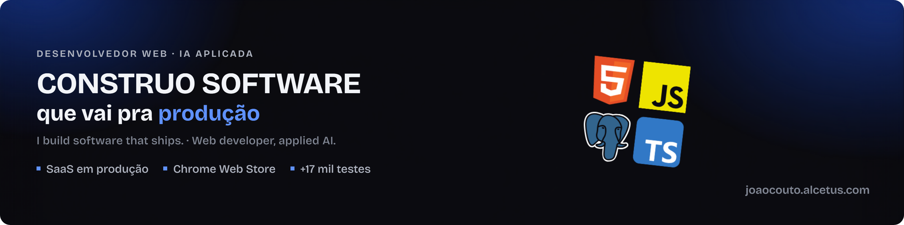
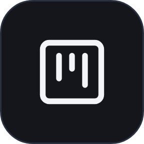
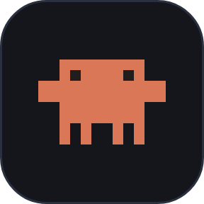
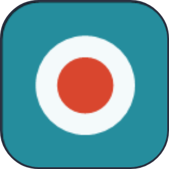
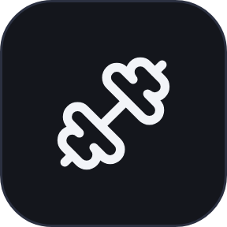
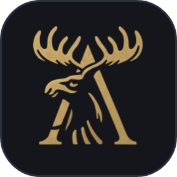

  

<a href="./README.md"><kbd>Português</kbd></a> <kbd><b>English</b></kbd>

  <a href="https://joaocouto.alcetus.com"><kbd> joaocouto.alcetus.com</kbd></a>
  <a href="mailto:joaopecouto77@gmail.com"><kbd> joaopecouto77@gmail.com</kbd></a>
  <a href="https://chromewebstore.google.com/detail/gravador-de-reuni%C3%A3o-%E2%86%92-mp3/oblcnhlpjjipaodcifnignjfdbgmmkdg?hl=en"><kbd> Chrome Web Store</kbd></a>

---

**Web Developer · React, TypeScript, Node.js, NestJS · Applied AI (Claude Code, MCP)**

<table>
<tr>
<td align="center" width="25%"><h2>17k+</h2>automated tests</td>
<td align="center" width="25%"><h2>20+</h2>official Anthropic courses</td>
<td align="center" width="25%"><h2>20+</h2>client websites delivered</td>
<td align="center" width="25%"><h2>1</h2>Chrome Web Store extension</td>
</tr>
</table>

### My story

In June 2022 I joined Captaris, a digital marketing agency, to build websites. Soon after I was also automating the request workflow with n8n and ClickUp and coordinating work between the Legal, Finance and Operations teams. The websites shipped with +20% monthly revenue, and the automation brought +45% efficiency to the processes.

In June 2024 I started serving clients on my own under the Alcetus brand: 20+ websites for industrial, automotive, tourism, law and retail businesses, from design to VPS deployment.

In 2026 I changed scale, from websites to products. I rewrote Mappex, which started on Supabase, into its own NestJS backend. I built zappex, a CRM inside WhatsApp Web, and Ok, Claude, a desktop app in Tauri and Rust. Claude Code is part of the workflow in all three, and I took 20+ official Anthropic courses to use it with method: subagents in isolated worktrees, hooks, and CI on every branch.

AI in my products has explicit limits. In Mappex, the model only picks from real OpenStreetMap neighborhoods. In Ok, Claude, the assistant does not make things up: information from outside the app only appears with a source and a link.

Today I am in the 3rd term of Systems Analysis and Development and open to opportunities as a developer.

### Projects

<table>
<tr>
<td width="120" align="center" valign="middle"></td>
<td valign="top"><b><a href="https://github.com/Joaopecouto/mappex-case">Mappex, Lead Generator</a></b> &nbsp;Live demo 
B2B lead-gen SaaS with a WhatsApp CRM, an interactive map and an AI that only picks from real OpenStreetMap neighborhoods. Rewritten from Supabase to its own NestJS backend.  
<kbd> React</kbd> <kbd> TypeScript</kbd> <kbd> NestJS</kbd> <kbd> PostgreSQL</kbd> <kbd> Leaflet</kbd>  
<a href="https://github.com/Joaopecouto/mappex-case">Project</a> · <a href="http://gerador-de-leads.alcetus.com">Demo</a></td>
</tr>
<tr>
<td width="120" align="center" valign="middle"></td>
<td valign="top"><b><a href="https://github.com/Joaopecouto/zappex-case">zappex</a></b> &nbsp;Private code 
Kanban CRM inside WhatsApp Web, built as a Chrome extension with a NestJS backend, Stripe billing and 6,000+ automated tests.  
<kbd> React</kbd> <kbd> TypeScript</kbd> <kbd> NestJS</kbd> <kbd> Stripe</kbd> <kbd> Chrome extension</kbd>  
<a href="https://github.com/Joaopecouto/zappex-case">Project</a></td>
</tr>
<tr>
<td width="120" align="center" valign="middle"></td>
<td valign="top"><b><a href="https://github.com/Joaopecouto/ok-claude-case">Ok, Claude</a></b> &nbsp;In development 
Windows desktop planner with an AI assistant that does not make things up: outside the app, only with a source and a link. Generated Rust and TypeScript contract, SQLite with backups.  
<kbd> Tauri</kbd> <kbd> Rust</kbd> <kbd> React</kbd> <kbd> SQLite</kbd> <kbd> Claude API</kbd>  
<a href="https://github.com/Joaopecouto/ok-claude-case">Project</a></td>
</tr>
<tr>
<td width="120" align="center" valign="middle"></td>
<td valign="top"><b><a href="https://github.com/Joaopecouto/TeamsAudioRecorder">Meeting Recorder</a></b> &nbsp;Chrome Web Store 
Extension that records audio, transcribes with speaker identification and summarizes Google Meet and Microsoft Teams meetings. Audio stays on your machine.  
<kbd> Manifest V3</kbd> <kbd> JavaScript</kbd> <kbd> Gemini API</kbd>  
<a href="https://github.com/Joaopecouto/TeamsAudioRecorder">Code</a> · <a href="https://chromewebstore.google.com/detail/gravador-de-reuni%C3%A3o-%E2%86%92-mp3/oblcnhlpjjipaodcifnignjfdbgmmkdg?hl=en">Chrome Web Store</a></td>
</tr>
<tr>
<td width="120" align="center" valign="middle"></td>
<td valign="top"><b><a href="https://github.com/Joaopecouto/gym-alcetus">Gym Alcetus</a></b> &nbsp;Live demo 
Workout tracker PWA with metrics, charts and a muscle heatmap.  
<kbd> React</kbd> <kbd> Fastify</kbd> <kbd> SQLite</kbd> <kbd> TypeScript</kbd>  
<a href="https://github.com/Joaopecouto/gym-alcetus">Code</a> · <a href="https://gym.alcetus.com">Demo</a></td>
</tr>
<tr>
<td width="120" align="center" valign="middle"></td>
<td valign="top"><b><a href="https://github.com/Joaopecouto/petala-dourada">Pétala Dourada</a></b> &nbsp;Demo 
Women's fashion e-commerce.  
<kbd> Next.js</kbd> <kbd> React</kbd> <kbd> TypeScript</kbd>  
<a href="https://github.com/Joaopecouto/petala-dourada">Project</a> · <a href="https://dev.petaladourada.com.br">Demo</a></td>
</tr>
<tr>
<td width="120" align="center" valign="middle"></td>
<td valign="top"><b><a href="https://github.com/Joaopecouto/sites-clientes">Client websites</a></b> &nbsp;Portfolio 
20+ websites for industry, automotive, tourism, legal and retail: Vetek, Catita, CEMC, MPA Máquinas, Rebecca Amorim and more.  
<kbd> WordPress</kbd> <kbd> Elementor</kbd> <kbd> HTML5</kbd> <kbd> Figma</kbd>  
<a href="https://github.com/Joaopecouto/sites-clientes">See the sites</a> · <a href="https://joaocouto.alcetus.com">Portfolio</a></td>
</tr>
<tr>
<td width="120" align="center" valign="middle"></td>
<td valign="top"><b><a href="https://github.com/Joaopecouto/DevRecap">DevRecap</a></b> &nbsp;Open source 
Windows tray app that scans your repositories at the end of the day and summarizes what you did.  
<kbd> Python</kbd> <kbd> PyInstaller</kbd>  
<a href="https://github.com/Joaopecouto/DevRecap">Code</a></td>
</tr>
</table>

### Tech stack

**AI** 
<kbd> Claude Code</kbd> <kbd> MCP</kbd> <kbd> Claude API</kbd> <kbd> Gemini API</kbd> <kbd> Groq</kbd>

**Front-end** 
<kbd> React</kbd> <kbd> TypeScript</kbd> <kbd> JavaScript</kbd> <kbd> Tailwind CSS</kbd> <kbd> Vite</kbd> <kbd> HTML5</kbd> <kbd> Next.js</kbd>

**Back-end and desktop** 
<kbd> Node.js</kbd> <kbd> NestJS</kbd> <kbd> Fastify</kbd> <kbd> Prisma</kbd> <kbd> PostgreSQL</kbd> <kbd> SQLite</kbd> <kbd> Redis</kbd> <kbd> Stripe</kbd> <kbd> Rust</kbd> <kbd> Tauri</kbd> <kbd> Python</kbd>

**Testing and DevOps** 
<kbd> Vitest</kbd> <kbd> Playwright</kbd> <kbd> GitHub Actions</kbd> <kbd> Docker</kbd> <kbd> Nginx</kbd> <kbd> Cloudflare</kbd> <kbd> Git</kbd> <kbd> n8n</kbd>

**Websites** 
<kbd> WordPress</kbd> <kbd> Elementor</kbd> <kbd> Figma</kbd>

### Experience

- **Freelance web developer, Alcetus brand** (Jun 2024 to present): corporate websites, landing pages and e-commerce with WordPress, Elementor, HTML, CSS, JavaScript and Figma; VPS deployment with Docker, Nginx and Cloudflare.
- **Captaris Marketing Digital** (Jun 2022 to Aug 2025): web and automation developer and operations manager. High-conversion websites (+20% monthly revenue), WhatsApp request automation with n8n and ClickUp (+45% efficiency), and request management across the Legal, Finance and Operations teams.

### Education and courses

- **Systems Analysis and Development** (technologist degree), Faculdade Descomplica, 3rd term in progress. **Electronics Technician**, FAETEC Ferreira Viana.
- **Anthropic, 20+ official courses (2026):** Claude 101, Claude Code 101, Claude Code in action, Claude Cowork, Claude Tag, Claude Platform 101, Model Context Protocol (introduction and advanced topics), Introduction to subagents, Introduction to agent skills, Building with the Claude API, Tool use with the Messages API, Introduction to evals, Claude with Amazon Bedrock, Claude on Google Cloud, AI Fluency, Building effective human-agent teams, The AI-native SDLC playbook.
- **Other:** Governance and Management Model (gestaopublicagov.br, 2026), Productivity and Organization and Project Tools and Techniques (Descomplica), and Comunidade Celados.

  <a href="https://joaocouto.alcetus.com"><kbd> joaocouto.alcetus.com</kbd></a>
  <a href="mailto:joaopecouto77@gmail.com"><kbd> joaopecouto77@gmail.com</kbd></a>
  <a href="https://chromewebstore.google.com/detail/gravador-de-reuni%C3%A3o-%E2%86%92-mp3/oblcnhlpjjipaodcifnignjfdbgmmkdg?hl=en"><kbd> Chrome Web Store</kbd></a>

