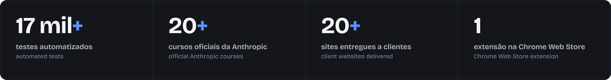
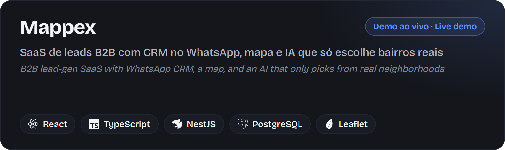
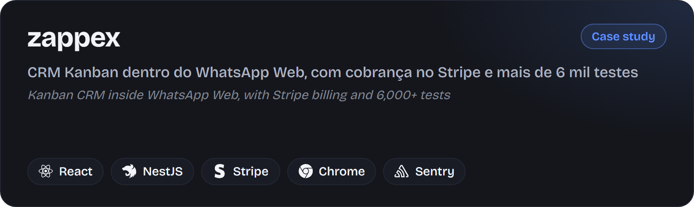
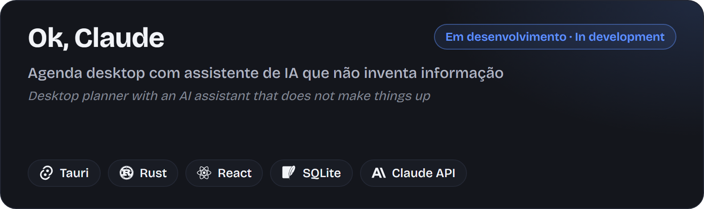
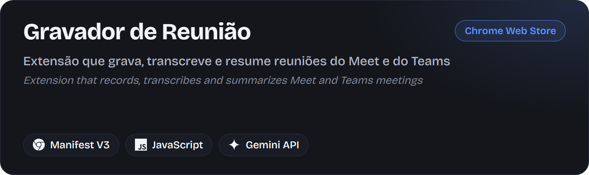
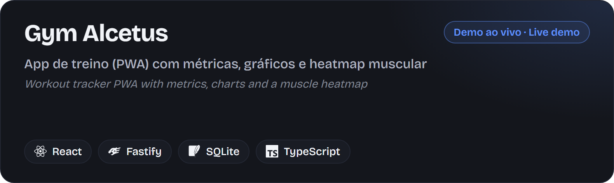
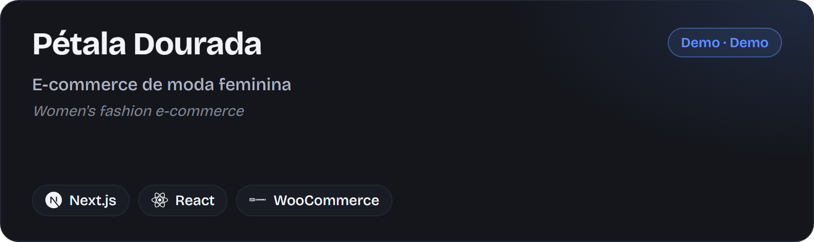
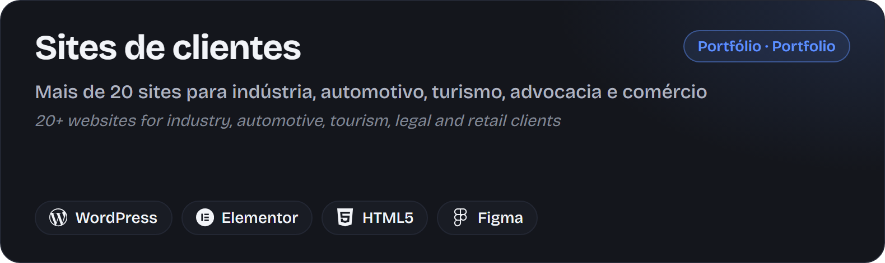
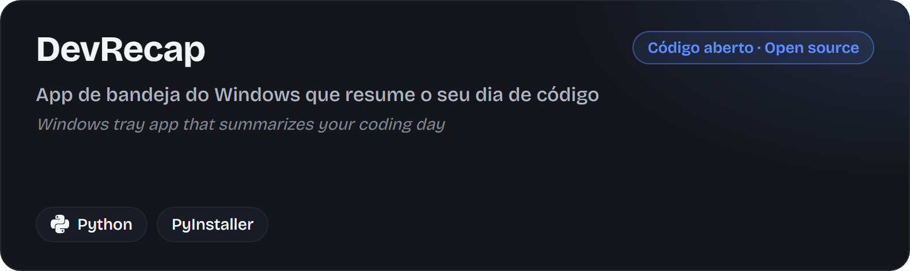
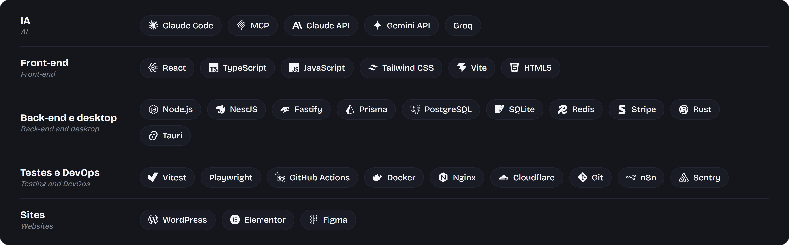

  

  <a href="#portugu%C3%AAs"><b>Português</b></a> &nbsp;|&nbsp; <a href="#english"><b>English</b></a>

  

  <a href="https://joaocouto.alcetus.com">joaocouto.alcetus.com</a> &nbsp;·&nbsp;
  <a href="mailto:joaopecouto77@gmail.com">joaopecouto77@gmail.com</a> &nbsp;·&nbsp;
  <a href="https://chromewebstore.google.com/detail/gravador-de-reuni%C3%A3o-%E2%86%92-mp3/oblcnhlpjjipaodcifnignjfdbgmmkdg?hl=pt-br">Chrome Web Store</a>

---

## Português

### Minha história

Comecei pela eletrônica: sou técnico formado pela FAETEC Ferreira Viana. Em junho de 2022 entrei na Captaris, uma agência de marketing digital, para fazer sites. Pouco depois também automatizava o fluxo de demandas com n8n e ClickUp e coordenava o trabalho entre Jurídico, Financeiro e Operacional. Os sites entregues vieram com +20% na receita mensal, e a automação trouxe +45% de eficiência aos processos.

Em junho de 2024 passei a atender clientes por conta própria, sob a marca Alcetus: mais de 20 sites para indústria, setor automotivo, turismo, advocacia e comércio, do desenho ao deploy em VPS.

Em 2026 mudei de escala, de sites para produtos. Reescrevi o Mappex, que nasceu em Supabase, para um backend próprio em NestJS. Construí o zappex, um CRM dentro do WhatsApp Web, e o Ok, Claude, um app desktop em Tauri e Rust. Nos três o Claude Code entrou no fluxo de trabalho, e fiz mais de 20 cursos oficiais da Anthropic para usá-lo com método: subagentes em worktrees isolados, hooks e CI em toda branch.

A IA nos meus produtos tem limite explícito. No Mappex, o modelo só escolhe entre bairros reais do OpenStreetMap. No Ok, Claude, o assistente não inventa: informação de fora do app só aparece com fonte e link.

Hoje estou no 3º trimestre de Análise e Desenvolvimento de Sistemas e aberto a oportunidades como desenvolvedor.

  

### Projetos

<table>
<tr>
<td width="50%"></td>
<td width="50%"></td>
</tr>
<tr>
<td width="50%"></td>
<td width="50%"></td>
</tr>
<tr>
<td width="50%"></td>
<td width="50%"></td>
</tr>
<tr>
<td width="50%"></td>
<td width="50%"></td>
</tr>
</table>

Demos: [Mappex](http://gerador-de-leads.alcetus.com) · [Gym Alcetus](https://gym.alcetus.com) · [Pétala Dourada](https://dev.petaladourada.com.br) · [Gravador de Reunião na Chrome Web Store](https://chromewebstore.google.com/detail/gravador-de-reuni%C3%A3o-%E2%86%92-mp3/oblcnhlpjjipaodcifnignjfdbgmmkdg?hl=pt-br)

### Tecnologias

### Experiência

- **Desenvolvedor web freelance, marca Alcetus** (jun/2024 até hoje): sites institucionais, landing pages e e-commerce com WordPress, Elementor, HTML, CSS, JavaScript e Figma; publicação em VPS com Docker, Nginx e Cloudflare.
- **Captaris Marketing Digital** (jun/2022 a ago/2025): desenvolvedor de sites e automação e gerente operacional. Sites de alta conversão (+20% na receita mensal), automação de demandas via WhatsApp com n8n e ClickUp (+45% de eficiência) e gestão de demandas entre Jurídico, Financeiro e Operacional.

### Formação e cursos

- **Análise e Desenvolvimento de Sistemas** (Tecnólogo), Faculdade Descomplica, cursando o 3º trimestre. **Técnico em Eletrônica**, FAETEC Ferreira Viana.
- **Anthropic, mais de 20 cursos oficiais (2026):** Claude 101, Claude Code 101, Claude Code in action, Claude Cowork, Claude Tag, Claude Platform 101, Model Context Protocol (introdução e tópicos avançados), Introduction to subagents, Introduction to agent skills, Building with the Claude API, Tool use with the Messages API, Introduction to evals, Claude with Amazon Bedrock, Claude on Google Cloud, AI Fluency, Building effective human-agent teams, The AI-native SDLC playbook.
- **Outros:** Modelo de Governança e Gestão (gestaopublicagov.br, 2026), Produtividade e Organização e Técnicas e Ferramentas para Projetos (Descomplica) e Comunidade Celados.

### Contato

[joaocouto.alcetus.com](https://joaocouto.alcetus.com) · [joaopecouto77@gmail.com](mailto:joaopecouto77@gmail.com) · Rio de Janeiro, Brasil

---

## English

### My story

I started in electronics: I am a certified technician from FAETEC Ferreira Viana. In June 2022 I joined Captaris, a digital marketing agency, to build websites. Soon after I was also automating the request workflow with n8n and ClickUp and coordinating work between the Legal, Finance and Operations teams. The websites shipped with +20% monthly revenue, and the automation brought +45% efficiency to the processes.

In June 2024 I started serving clients on my own under the Alcetus brand: 20+ websites for industrial, automotive, tourism, law and retail businesses, from design to VPS deployment.

In 2026 I changed scale, from websites to products. I rewrote Mappex, which started on Supabase, into its own NestJS backend. I built zappex, a CRM inside WhatsApp Web, and Ok, Claude, a desktop app in Tauri and Rust. Claude Code is part of the workflow in all three, and I took 20+ official Anthropic courses to use it with method: subagents in isolated worktrees, hooks, and CI on every branch.

AI in my products has explicit limits. In Mappex, the model only picks from real OpenStreetMap neighborhoods. In Ok, Claude, the assistant does not make things up: information from outside the app only appears with a source and a link.

Today I am in the 3rd term of Systems Analysis and Development and open to opportunities as a developer.

  

### Projects

<table>
<tr>
<td width="50%"></td>
<td width="50%"></td>
</tr>
<tr>
<td width="50%"></td>
<td width="50%"></td>
</tr>
<tr>
<td width="50%"></td>
<td width="50%"></td>
</tr>
<tr>
<td width="50%"></td>
<td width="50%"></td>
</tr>
</table>

Demos: [Mappex](http://gerador-de-leads.alcetus.com) · [Gym Alcetus](https://gym.alcetus.com) · [Pétala Dourada](https://dev.petaladourada.com.br) · [Meeting Recorder on the Chrome Web Store](https://chromewebstore.google.com/detail/gravador-de-reuni%C3%A3o-%E2%86%92-mp3/oblcnhlpjjipaodcifnignjfdbgmmkdg?hl=en)

### Tech stack

### Experience

- **Freelance web developer, Alcetus brand** (Jun 2024 to present): corporate websites, landing pages and e-commerce with WordPress, Elementor, HTML, CSS, JavaScript and Figma; VPS deployment with Docker, Nginx and Cloudflare.
- **Captaris Marketing Digital** (Jun 2022 to Aug 2025): web and automation developer and operations manager. High-conversion websites (+20% monthly revenue), WhatsApp request automation with n8n and ClickUp (+45% efficiency), and request management across the Legal, Finance and Operations teams.

### Education and courses

- **Systems Analysis and Development** (technologist degree), Faculdade Descomplica, 3rd term in progress. **Electronics Technician**, FAETEC Ferreira Viana.
- **Anthropic, 20+ official courses (2026):** Claude 101, Claude Code 101, Claude Code in action, Claude Cowork, Claude Tag, Claude Platform 101, Model Context Protocol (introduction and advanced topics), Introduction to subagents, Introduction to agent skills, Building with the Claude API, Tool use with the Messages API, Introduction to evals, Claude with Amazon Bedrock, Claude on Google Cloud, AI Fluency, Building effective human-agent teams, The AI-native SDLC playbook.
- **Other:** Governance and Management Model (gestaopublicagov.br, 2026), Productivity and Organization and Project Tools and Techniques (Descomplica), and Comunidade Celados.

### Contact

[joaocouto.alcetus.com](https://joaocouto.alcetus.com) · [joaopecouto77@gmail.com](mailto:joaopecouto77@gmail.com) · Rio de Janeiro, Brazil
