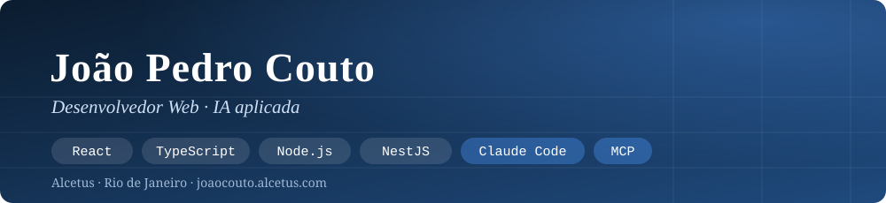

  

  <b>Desenvolvedor Web · React, TypeScript, Node.js, NestJS · IA aplicada</b> 
  <i>Web Developer · React, TypeScript, Node.js, NestJS · Applied AI</i>

  
  
  

---

<table>
<tr>
<td valign="top" width="50%">

#### 🇧🇷 Sobre

Desenvolvimento de **SaaS, CRMs, extensões de navegador e apps desktop** com React, TypeScript, Node.js, NestJS e PostgreSQL, sob a marca **Alcetus**.

- 🤖 **IA aplicada:** Claude Code (subagentes, hooks, skills), MCP e integração de LLMs via API (Claude, Gemini, Groq)
- 🎓 **Mais de 20 cursos oficiais da Anthropic** (Claude Code, MCP, subagents, Agent Skills, Claude API, evals)
- 🧪 **Mais de 17 mil testes automatizados** nos projetos (Vitest, Playwright, axe-core)
- 🌐 **Mais de 20 sites entregues** a clientes com WordPress, Elementor, HTML, CSS e JavaScript
- 📚 Cursando Análise e Desenvolvimento de Sistemas (Descomplica)

</td>
<td valign="top" width="50%">

#### 🇺🇸 About

Building **SaaS, CRMs, browser extensions and desktop apps** with React, TypeScript, Node.js, NestJS and PostgreSQL, under the **Alcetus** brand.

- 🤖 **Applied AI:** Claude Code (subagents, hooks, skills), MCP and LLM integration through APIs (Claude, Gemini, Groq)
- 🎓 **20+ official Anthropic courses** (Claude Code, MCP, subagents, Agent Skills, Claude API, evals)
- 🧪 **17,000+ automated tests** across projects (Vitest, Playwright, axe-core)
- 🌐 **20+ websites delivered** for clients with WordPress, Elementor, HTML, CSS and JavaScript
- 📚 Studying Systems Analysis and Development (Descomplica)

</td>
</tr>
</table>

---

### 🚀 Projetos em destaque · Featured projects

| Projeto · Project | O que é · What it is | Links |
| --- | --- | --- |
| **Mappex, Gerador de Leads** | SaaS de leads B2B com CRM no WhatsApp, mapa e IA que só escolhe entre bairros reais · <i>B2B lead-gen SaaS with WhatsApp CRM</i> | [📂 Case](https://github.com/Joaopecouto/mappex-case) · [🌐 Demo](http://gerador-de-leads.alcetus.com) |
| **zappex** | CRM Kanban dentro do WhatsApp Web: extensão Chrome, backend NestJS e cobrança com Stripe · <i>Kanban CRM inside WhatsApp Web</i> | [📂 Case](https://github.com/Joaopecouto/zappex-case) |
| **Ok, Claude** | Agenda desktop com assistente de IA: Tauri 2, Rust, React 19 e SQLite · <i>Desktop planner with an AI assistant</i> | [📂 Case](https://github.com/Joaopecouto/ok-claude-case) |
| **Gravador de Reunião** | Extensão Chrome (Manifest V3) que grava, transcreve e resume reuniões do Meet e do Teams · <i>Meeting recorder and summarizer</i> | [💻 Código](https://github.com/Joaopecouto/TeamsAudioRecorder) · [🧩 Chrome Web Store](https://chromewebstore.google.com/detail/gravador-de-reuni%C3%A3o-%E2%86%92-mp3/oblcnhlpjjipaodcifnignjfdbgmmkdg?hl=pt-br) |
| **Gym Alcetus** | App de treino (PWA) com métricas e heatmap muscular · <i>Workout tracker PWA</i> | [💻 Código](https://github.com/Joaopecouto/gym-alcetus) · [🌐 Demo](https://gym.alcetus.com) |
| **Pétala Dourada** | E-commerce de moda feminina · <i>Fashion e-commerce</i> | [📂 Case](https://github.com/Joaopecouto/petala-dourada) · [🌐 Demo](https://dev.petaladourada.com.br) |
| **Sites de clientes** | Vetek, Catita, CEMC, MPA Máquinas, Rebecca Amorim e outros · <i>Client websites</i> | [📂 Ver · See](https://github.com/Joaopecouto/sites-clientes) |
| **DevRecap** | App de bandeja do Windows que resume o dia de código · <i>Windows tray app that summarizes your coding day</i> | [💻 Código](https://github.com/Joaopecouto/DevRecap) |

---

### 🧰 Tecnologias · Tech stack

**IA · AI**

**Front-end**

**Back-end e desktop · Back-end and desktop**

**Testes e DevOps · Testing and DevOps**

**Sites · Websites**

---

### 💼 Experiência · Experience

- **Desenvolvedor web freelance** (marca Alcetus), jun/2024 até hoje: sites institucionais, landing pages e e-commerce para clientes industriais, automotivos, de turismo, jurídicos e de comércio · <i>Freelance web developer</i>
- **Captaris Marketing Digital**, jun/2022 a ago/2025: desenvolvimento de sites, automações com n8n e ClickUp e gestão operacional · <i>Web developer, automation and operations</i>

---

  📫 <a href="mailto:joaopecouto77@gmail.com">joaopecouto77@gmail.com</a> · 🌐 <a href="https://joaocouto.alcetus.com">joaocouto.alcetus.com</a> · 📍 Rio de Janeiro, Brasil

