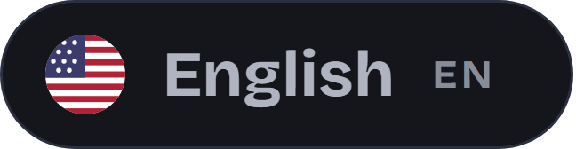
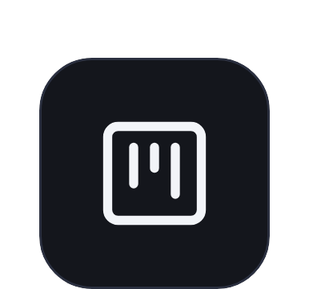
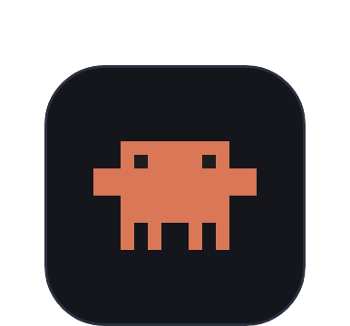
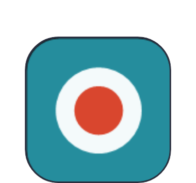
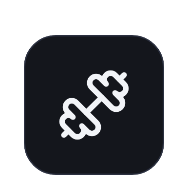
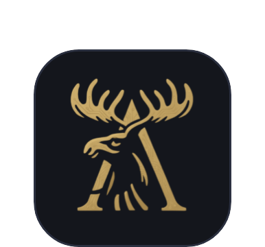
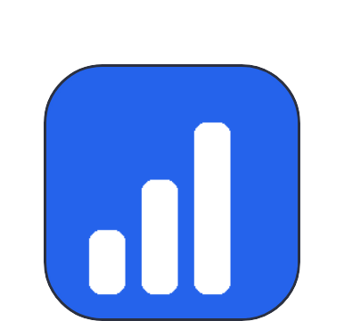

  

 &nbsp; 

  <a href="https://joaocouto.alcetus.com"><kbd>&nbsp;&nbsp; joaocouto.alcetus.com&nbsp;&nbsp;</kbd></a> &nbsp;
  <a href="mailto:joaopecouto77@gmail.com"><kbd>&nbsp;&nbsp; joaopecouto77@gmail.com&nbsp;&nbsp;</kbd></a> &nbsp;
  <a href="https://chromewebstore.google.com/detail/gravador-de-reuni%C3%A3o-%E2%86%92-mp3/oblcnhlpjjipaodcifnignjfdbgmmkdg?hl=pt-br"><kbd>&nbsp;&nbsp; Chrome Web Store&nbsp;&nbsp;</kbd></a>

---

**Desenvolvedor Web · React, TypeScript, Node.js, NestJS · IA aplicada (Claude Code, MCP)**

<table>
<tr>
<td align="center" width="25%"><h2>17 mil+</h2>testes automatizados</td>
<td align="center" width="25%"><h2>20+</h2>cursos oficiais da Anthropic</td>
<td align="center" width="25%"><h2>20+</h2>sites entregues a clientes</td>
<td align="center" width="25%"><h2>1</h2>extensão na Chrome Web Store</td>
</tr>
</table>

### Minha história

Em junho de 2022 entrei na Captaris, uma agência de marketing digital, para fazer sites. Pouco depois eu já estava automatizando o fluxo de demandas com n8n e ClickUp e coordenando o trabalho entre Jurídico, Financeiro e Operacional. Os sites entregues vieram com +20% na receita mensal, e a automação trouxe +45% de eficiência aos processos.

Em junho de 2024 passei a atender clientes por conta própria, sob a marca Alcetus. Foram mais de 20 sites para indústria, setor automotivo, turismo, advocacia e comércio, do desenho até o deploy em VPS.

Em 2026 eu mudei de escala, de sites para produtos. Reescrevi o Mappex, que nasceu em Supabase, para um backend próprio em NestJS, e construí o zappex, um CRM dentro do WhatsApp Web, e o Ok, Claude, um app desktop em Tauri e Rust. Nos três o Claude Code entrou no meu fluxo de trabalho, e aí eu fiz mais de 20 cursos oficiais da Anthropic para usar isso com método: subagentes em worktrees isolados, hooks e CI em toda branch.

A IA nos meus produtos tem um limite bem explícito. No Mappex, o modelo só escolhe entre bairros reais do OpenStreetMap. No Ok, Claude, o assistente não inventa nada: informação de fora do app só aparece com fonte e link.

Hoje eu estou no 3º trimestre de Análise e Desenvolvimento de Sistemas e aberto a oportunidades como desenvolvedor.

  

### Projetos

<table>
<tr>
<td width="144" align="center" valign="top"></td>
<td valign="top"><h3><a href="https://github.com/Joaopecouto/mappex-case">Mappex, Gerador de Leads</a> &nbsp;Demo ao vivo</h3>
SaaS de leads B2B com CRM no WhatsApp, mapa interativo e uma IA que só escolhe entre bairros reais do OpenStreetMap. Reescrito de Supabase para backend próprio em NestJS.  
<kbd>&nbsp;&nbsp; React&nbsp;&nbsp;</kbd> &nbsp;<kbd>&nbsp;&nbsp; TypeScript&nbsp;&nbsp;</kbd> &nbsp;<kbd>&nbsp;&nbsp; NestJS&nbsp;&nbsp;</kbd> &nbsp;<kbd>&nbsp;&nbsp; PostgreSQL&nbsp;&nbsp;</kbd> &nbsp;<kbd>&nbsp;&nbsp; Leaflet&nbsp;&nbsp;</kbd>  
<a href="https://github.com/Joaopecouto/mappex-case">Projeto</a> &nbsp;·&nbsp; <a href="http://gerador-de-leads.alcetus.com">Demo</a>  </td>
</tr>
<tr>
<td width="144" align="center" valign="top"></td>
<td valign="top"><h3><a href="https://github.com/Joaopecouto/zappex-case">zappex</a> &nbsp;Código privado</h3>
CRM Kanban dentro do WhatsApp Web, em extensão do Chrome com backend NestJS, cobrança no Stripe e mais de 6 mil testes automatizados.  
<kbd>&nbsp;&nbsp; React&nbsp;&nbsp;</kbd> &nbsp;<kbd>&nbsp;&nbsp; TypeScript&nbsp;&nbsp;</kbd> &nbsp;<kbd>&nbsp;&nbsp; NestJS&nbsp;&nbsp;</kbd> &nbsp;<kbd>&nbsp;&nbsp; Stripe&nbsp;&nbsp;</kbd> &nbsp;<kbd>&nbsp;&nbsp; Chrome extension&nbsp;&nbsp;</kbd>  
<a href="https://github.com/Joaopecouto/zappex-case">Projeto</a>  </td>
</tr>
<tr>
<td width="144" align="center" valign="top"></td>
<td valign="top"><h3><a href="https://github.com/Joaopecouto/ok-claude-case">Ok, Claude</a> &nbsp;Em desenvolvimento</h3>
Agenda desktop para Windows com assistente de IA que não inventa informação: fora do app, só com fonte e link. Contrato Rust e TypeScript gerado e SQLite com backup.  
<kbd>&nbsp;&nbsp; Tauri&nbsp;&nbsp;</kbd> &nbsp;<kbd>&nbsp;&nbsp; Rust&nbsp;&nbsp;</kbd> &nbsp;<kbd>&nbsp;&nbsp; React&nbsp;&nbsp;</kbd> &nbsp;<kbd>&nbsp;&nbsp; SQLite&nbsp;&nbsp;</kbd> &nbsp;<kbd>&nbsp;&nbsp; Claude API&nbsp;&nbsp;</kbd>  
<a href="https://github.com/Joaopecouto/ok-claude-case">Projeto</a>  </td>
</tr>
<tr>
<td width="144" align="center" valign="top"></td>
<td valign="top"><h3><a href="https://github.com/Joaopecouto/TeamsAudioRecorder">Gravador de Reunião</a> &nbsp;Chrome Web Store</h3>
Extensão que grava o áudio, transcreve com identificação de quem fala e resume reuniões do Google Meet e do Microsoft Teams. O áudio fica na máquina.  
<kbd>&nbsp;&nbsp; Manifest V3&nbsp;&nbsp;</kbd> &nbsp;<kbd>&nbsp;&nbsp; JavaScript&nbsp;&nbsp;</kbd> &nbsp;<kbd>&nbsp;&nbsp; Gemini API&nbsp;&nbsp;</kbd>  
<a href="https://github.com/Joaopecouto/TeamsAudioRecorder">Código</a> &nbsp;·&nbsp; <a href="https://chromewebstore.google.com/detail/gravador-de-reuni%C3%A3o-%E2%86%92-mp3/oblcnhlpjjipaodcifnignjfdbgmmkdg?hl=pt-br">Chrome Web Store</a>  </td>
</tr>
<tr>
<td width="144" align="center" valign="top"></td>
<td valign="top"><h3><a href="https://github.com/Joaopecouto/gym-alcetus">Gym Alcetus</a> &nbsp;Demo ao vivo</h3>
App de treino (PWA) com métricas, gráficos e heatmap muscular.  
<kbd>&nbsp;&nbsp; React&nbsp;&nbsp;</kbd> &nbsp;<kbd>&nbsp;&nbsp; Fastify&nbsp;&nbsp;</kbd> &nbsp;<kbd>&nbsp;&nbsp; SQLite&nbsp;&nbsp;</kbd> &nbsp;<kbd>&nbsp;&nbsp; TypeScript&nbsp;&nbsp;</kbd>  
<a href="https://github.com/Joaopecouto/gym-alcetus">Código</a> &nbsp;·&nbsp; <a href="https://gym.alcetus.com">Demo</a>  </td>
</tr>
<tr>
<td width="144" align="center" valign="top"></td>
<td valign="top"><h3><a href="https://github.com/Joaopecouto/petala-dourada">Pétala Dourada</a> &nbsp;Demo</h3>
E-commerce de moda feminina.  
<kbd>&nbsp;&nbsp; Next.js&nbsp;&nbsp;</kbd> &nbsp;<kbd>&nbsp;&nbsp; React&nbsp;&nbsp;</kbd> &nbsp;<kbd>&nbsp;&nbsp; TypeScript&nbsp;&nbsp;</kbd>  
<a href="https://github.com/Joaopecouto/petala-dourada">Projeto</a> &nbsp;·&nbsp; <a href="https://dev.petaladourada.com.br">Demo</a>  </td>
</tr>
<tr>
<td width="144" align="center" valign="top"></td>
<td valign="top"><h3><a href="https://github.com/Joaopecouto/sites-clientes">Sites de clientes</a> &nbsp;Portfólio</h3>
Mais de 20 sites para indústria, automotivo, turismo, advocacia e comércio: Vetek, Catita, CEMC, MPA Máquinas, Rebecca Amorim e outros.  
<kbd>&nbsp;&nbsp; WordPress&nbsp;&nbsp;</kbd> &nbsp;<kbd>&nbsp;&nbsp; Elementor&nbsp;&nbsp;</kbd> &nbsp;<kbd>&nbsp;&nbsp; HTML5&nbsp;&nbsp;</kbd> &nbsp;<kbd>&nbsp;&nbsp; Figma&nbsp;&nbsp;</kbd>  
<a href="https://github.com/Joaopecouto/sites-clientes">Ver sites</a> &nbsp;·&nbsp; <a href="https://joaocouto.alcetus.com">Portfólio</a>  </td>
</tr>
<tr>
<td width="144" align="center" valign="top"></td>
<td valign="top"><h3><a href="https://github.com/Joaopecouto/DevRecap">DevRecap</a> &nbsp;Código aberto</h3>
App de bandeja do Windows que varre os repositórios no fim do dia e resume o que foi feito.  
<kbd>&nbsp;&nbsp; Python&nbsp;&nbsp;</kbd> &nbsp;<kbd>&nbsp;&nbsp; PyInstaller&nbsp;&nbsp;</kbd>  
<a href="https://github.com/Joaopecouto/DevRecap">Código</a>  </td>
</tr>
</table>

### Tecnologias

**IA** 
<kbd>&nbsp;&nbsp; Claude Code&nbsp;&nbsp;</kbd> &nbsp;<kbd>&nbsp;&nbsp; MCP&nbsp;&nbsp;</kbd> &nbsp;<kbd>&nbsp;&nbsp; Claude API&nbsp;&nbsp;</kbd> &nbsp;<kbd>&nbsp;&nbsp; Gemini API&nbsp;&nbsp;</kbd> &nbsp;<kbd>&nbsp;&nbsp; Groq&nbsp;&nbsp;</kbd>

**Front-end** 
<kbd>&nbsp;&nbsp; React&nbsp;&nbsp;</kbd> &nbsp;<kbd>&nbsp;&nbsp; TypeScript&nbsp;&nbsp;</kbd> &nbsp;<kbd>&nbsp;&nbsp; JavaScript&nbsp;&nbsp;</kbd> &nbsp;<kbd>&nbsp;&nbsp; Tailwind CSS&nbsp;&nbsp;</kbd> &nbsp;<kbd>&nbsp;&nbsp; Vite&nbsp;&nbsp;</kbd> &nbsp;<kbd>&nbsp;&nbsp; HTML5&nbsp;&nbsp;</kbd> &nbsp;<kbd>&nbsp;&nbsp; Next.js&nbsp;&nbsp;</kbd>

**Back-end e desktop** 
<kbd>&nbsp;&nbsp; Node.js&nbsp;&nbsp;</kbd> &nbsp;<kbd>&nbsp;&nbsp; NestJS&nbsp;&nbsp;</kbd> &nbsp;<kbd>&nbsp;&nbsp; Fastify&nbsp;&nbsp;</kbd> &nbsp;<kbd>&nbsp;&nbsp; Prisma&nbsp;&nbsp;</kbd> &nbsp;<kbd>&nbsp;&nbsp; PostgreSQL&nbsp;&nbsp;</kbd> &nbsp;<kbd>&nbsp;&nbsp; SQLite&nbsp;&nbsp;</kbd> &nbsp;<kbd>&nbsp;&nbsp; Redis&nbsp;&nbsp;</kbd> &nbsp;<kbd>&nbsp;&nbsp; Stripe&nbsp;&nbsp;</kbd> &nbsp;<kbd>&nbsp;&nbsp; Rust&nbsp;&nbsp;</kbd> &nbsp;<kbd>&nbsp;&nbsp; Tauri&nbsp;&nbsp;</kbd> &nbsp;<kbd>&nbsp;&nbsp; Python&nbsp;&nbsp;</kbd>

**Testes e DevOps** 
<kbd>&nbsp;&nbsp; Vitest&nbsp;&nbsp;</kbd> &nbsp;<kbd>&nbsp;&nbsp; Playwright&nbsp;&nbsp;</kbd> &nbsp;<kbd>&nbsp;&nbsp; GitHub Actions&nbsp;&nbsp;</kbd> &nbsp;<kbd>&nbsp;&nbsp; Docker&nbsp;&nbsp;</kbd> &nbsp;<kbd>&nbsp;&nbsp; Nginx&nbsp;&nbsp;</kbd> &nbsp;<kbd>&nbsp;&nbsp; Cloudflare&nbsp;&nbsp;</kbd> &nbsp;<kbd>&nbsp;&nbsp; Git&nbsp;&nbsp;</kbd> &nbsp;<kbd>&nbsp;&nbsp; n8n&nbsp;&nbsp;</kbd>

**Sites** 
<kbd>&nbsp;&nbsp; WordPress&nbsp;&nbsp;</kbd> &nbsp;<kbd>&nbsp;&nbsp; Elementor&nbsp;&nbsp;</kbd> &nbsp;<kbd>&nbsp;&nbsp; Figma&nbsp;&nbsp;</kbd>

### Experiência

- **Desenvolvedor web freelance, marca Alcetus** (jun/2024 até hoje): sites institucionais, landing pages e e-commerce com WordPress, Elementor, HTML, CSS, JavaScript e Figma; publicação em VPS com Docker, Nginx e Cloudflare.
- **Captaris Marketing Digital** (jun/2022 a ago/2025): desenvolvedor de sites e automação e gerente operacional. Sites de alta conversão (+20% na receita mensal), automação de demandas via WhatsApp com n8n e ClickUp (+45% de eficiência) e gestão de demandas entre Jurídico, Financeiro e Operacional.

### Formação e cursos

- **Análise e Desenvolvimento de Sistemas** (Tecnólogo), Faculdade Descomplica, cursando o 3º trimestre. **Técnico em Eletrônica**, FAETEC Ferreira Viana.
- **Anthropic, mais de 20 cursos oficiais (2026):** Claude 101, Claude Code 101, Claude Code in action, Claude Cowork, Claude Tag, Claude Platform 101, Model Context Protocol (introdução e tópicos avançados), Introduction to subagents, Introduction to agent skills, Building with the Claude API, Tool use with the Messages API, Introduction to evals, Claude with Amazon Bedrock, Claude on Google Cloud, AI Fluency, Building effective human-agent teams, The AI-native SDLC playbook.
- **Outros:** Modelo de Governança e Gestão (gestaopublicagov.br, 2026), Produtividade e Organização e Técnicas e Ferramentas para Projetos (Descomplica) e Comunidade Celados.

  <a href="https://joaocouto.alcetus.com"><kbd>&nbsp;&nbsp; joaocouto.alcetus.com&nbsp;&nbsp;</kbd></a> &nbsp;
  <a href="mailto:joaopecouto77@gmail.com"><kbd>&nbsp;&nbsp; joaopecouto77@gmail.com&nbsp;&nbsp;</kbd></a> &nbsp;
  <a href="https://chromewebstore.google.com/detail/gravador-de-reuni%C3%A3o-%E2%86%92-mp3/oblcnhlpjjipaodcifnignjfdbgmmkdg?hl=pt-br"><kbd>&nbsp;&nbsp; Chrome Web Store&nbsp;&nbsp;</kbd></a>

